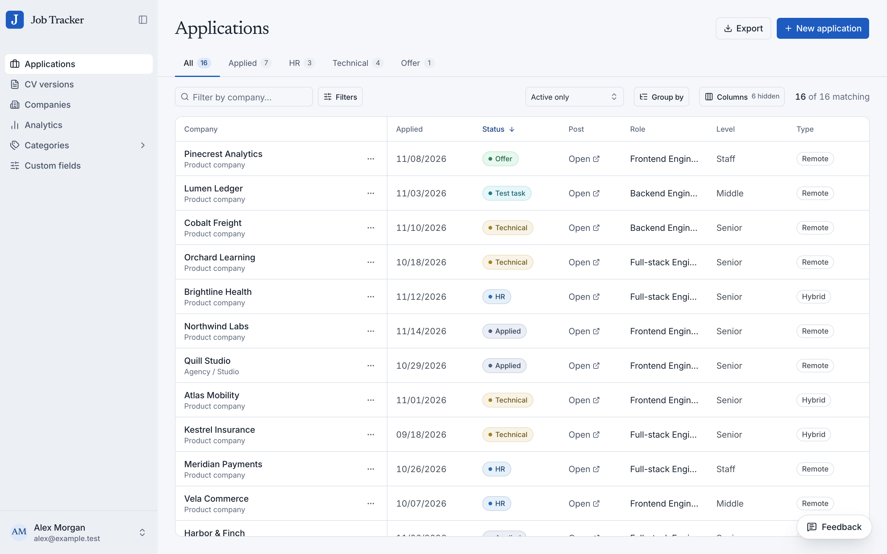
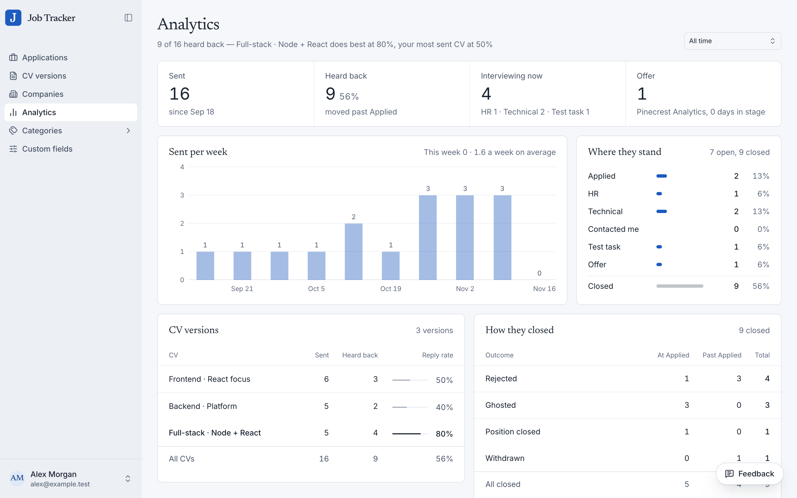
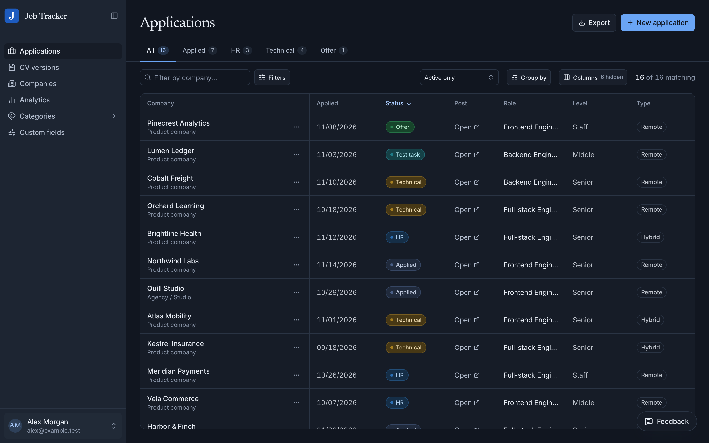

# Job Tracker

[](https://github.com/mtsylko/simple-job-tracker/actions/workflows/ci.yml)
[](LICENSE)

A tracker for a job search. It keeps every application with its stage, the CV
version you sent and the companies you want to skip. An analytics page shows
which CV gets replies and where applications stop.

Live at [simplejobtracker.com](https://simplejobtracker.com). This repository
holds the free version of the app.



| Analytics                                         | Dark theme                                                 |
| ------------------------------------------------- | ---------------------------------------------------------- |
|  |  |

## Features

- **Applications.** Status tabs, filters, grouping, sorting and column choice.
  The table state is kept in the URL, so a filtered view can be bookmarked.
- **Your own categories.** Roles, levels, work types, statuses, outcomes,
  employment and contract types are lists you edit. Renaming a value renames
  it everywhere.
- **Custom fields.** Add fields to the application form and reorder it.
- **CV versions.** Track which CV went where, with a stored PDF or a link.
- **Analytics.** Applications per week, reply rate per CV, where open
  applications stand and how closed ones ended.
- **Companies.** A blacklist with reasons, so you skip a company you already
  ruled out.
- **Your data.** Export everything as a file, or delete the account with
  everything in it.
- **Five languages** (English, Polish, Russian, Ukrainian, Belarusian), light
  and dark themes, and a phone layout.

## Tech stack

TypeScript end to end.

| Layer     | Tools                                                                                                                                                                                                       |
| --------- | ----------------------------------------------------------------------------------------------------------------------------------------------------------------------------------------------------------- |
| Front end | React 19, Vite, Tailwind CSS v4, Base UI with shadcn components, React Router 7, TanStack Table and Virtual, Zustand, nuqs (state in the URL), React Hook Form with Zod 4, Recharts, dnd-kit, react-i18next |
| Back end  | Node.js, NestJS 11, TypeORM 0.3, PostgreSQL 17, Zod 4 validation, Passport (Google OAuth 2.0 and JWT), `@nestjs/schedule`, Pino logging                                                                     |
| Shared    | Types and constants imported by both sides                                                                                                                                                                  |
| Tooling   | Yarn 4 workspaces, ESLint 9, Prettier, Vitest, Docker Compose, GitHub Actions, Copybara                                                                                                                     |

## Architecture

A Yarn 4 monorepo with three workspaces:

```
web-api/    the REST API
web-front/  the single-page app
shared/     types and constants that both sides import
```

Some decisions worth a look:

- **One contract for both sides.** Request and response types live in
  `shared`. The API validates every payload with Zod in a
  `ZodValidationPipe`, so a contract change breaks the build, not production.
- **Schema by migrations only.** `synchronize` is off everywhere, and the API
  runs pending TypeORM migrations when it starts.
- **Categories as tables, not text.** Each category is an option table
  referenced by foreign key, so a rename applies to every application at once.
  Custom field values sit in a `jsonb` column next to a table of field
  definitions.
- **Data scoped to the user.** Google OAuth issues a JWT in an HTTP-only
  cookie, and every query filters by the signed-in user. Stored CVs are served
  through an authenticated route, never as static files. Scheduled jobs remove
  uploads that nobody claimed.
- **Errors with codes.** The API returns `{ message, code }`, and the web app
  shows its own translated text for each code.
- **Long lists stay fast.** The tables use TanStack Table with TanStack
  Virtual, and state lives in small Zustand stores.

## Run it locally

You need Docker, Node.js 20 or newer and Yarn 4 (`corepack enable`).

1. Create a Google OAuth client (type "Web application") with the redirect URI
   `http://localhost:3000/auth/google/callback`.
2. Create `web-api/.env`:

   ```
   GOOGLE_CLIENT_ID=...
   GOOGLE_CLIENT_SECRET=...
   GOOGLE_CALLBACK_URL=http://localhost:3000/auth/google/callback
   FRONTEND_URL=http://localhost:5173
   JWT_SECRET=any-long-random-string
   # Optional: these addresses get the admin pages.
   ADMIN_EMAILS=you@example.com
   ```

3. Start the stack:

   ```
   yarn install
   docker compose up
   ```

4. Open http://localhost:5173 and sign in with Google.

## Checks

The same checks run in CI on every push:

```
yarn workspace job-tracker-api build
yarn workspace job-tracker-api lint
yarn workspace job-tracker-api test
yarn workspace web-front lint
yarn workspace web-front build
yarn workspace job-tracker-e2e lint
yarn workspace job-tracker-e2e compile
yarn workspace job-tracker-e2e test
```

The last one runs the browser tests of the main flow. It needs Postgres and a
local Chromium: see [e2e/README.md](e2e/README.md).

## How this repository is published

The product lives in a private repository, which also holds the paid features.
On every merge there, [Copybara](https://github.com/google/copybara) exports
the free part to this repository: it leaves out the private modules and the
lines that wire them in. The export then builds and tests the result, and
publishes it only if every check passes. Each sync arrives here as one commit.

Pull requests are welcome. Changes are moved into the private repository by
hand and come back here with the next sync.

## License

[AGPL-3.0](LICENSE). You may use, change and share this code. If you run a
changed version as a service for other people, you must publish your changes
under the same license.
